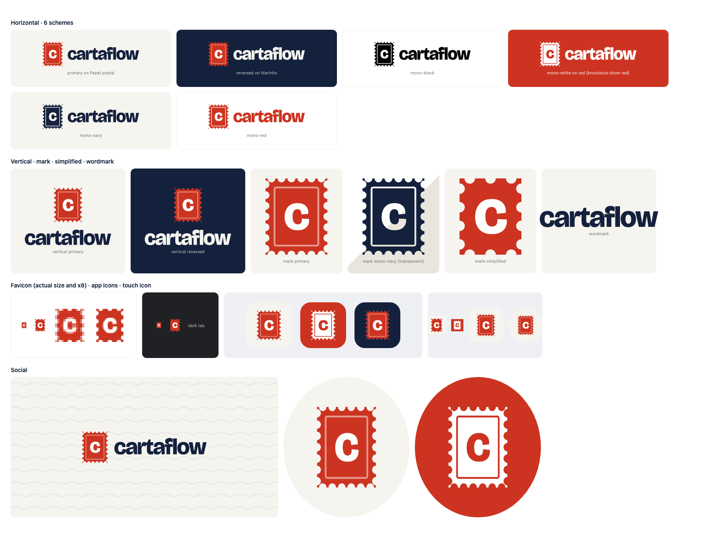

# CartaFlow logos

Every file here is generated by `node scripts/build-logos.mjs` from `logos/src/glyphs.json` (the outlined wordmark and stamp "c") and the stamp geometry in the script. Don't edit exported files by hand. Change the script and rebuild.

The logos have no live text: the wordmark is converted to vector outlines, so they look identical everywhere, with or without the font installed. There are no SVG masks either. One-color versions use real transparent knockouts (compound paths with `fill-rule="evenodd"`), so they work in Figma, Illustrator and print RIPs.



## Lockups

| Lockup | File stem | Use it for |
|---|---|---|
| Horizontal | `cartaflow-horizontal-*` | The default logo: site header, documents, envelopes, email signatures, partner pages |
| Vertical | `cartaflow-vertical-*` | Square or tall spaces: splash screens, merch, social posts, event badges |
| Mark | `cartaflow-mark-*` | When the name is already visible nearby, or as a stamp or seal graphic |
| Mark, simplified | `cartaflow-mark-simplified-*` | Any rendering at 32 px or smaller: favicons, tiny avatars, browser tabs |
| Wordmark | `cartaflow-wordmark-*` | Rare. Only where the stamp can't appear, such as running text headers or co-branding lines |

## Color schemes

| Scheme | Colors | Use it on |
|---|---|---|
| `primary` | Red stamp `#CC3421`, white "c" `#FFFEFB`, frame `#E6998E`, navy wordmark `#14213D` | Papel postal `#F6F4EF`, white and other light surfaces. The default. |
| `reversed` | Red stamp, paper-white "c", Papel postal wordmark `#F6F4EF` | Marinho `#14213D` or darker surfaces only |
| `mono-black` | `#000000`, knocked out | One-color black printing: laser-printed letters, fax, stamps |
| `mono-white` | `#FFFFFF`, knocked out | Over red, navy, photos and dark surfaces when color can't be used |
| `mono-navy` | `#14213D`, knocked out | One-color navy printing, embossing, quiet light-background placements |
| `mono-red` | `#CC3421`, knocked out | One-color red printing, rubber stamps, packaging tape |

## Folders

| Folder | What's inside |
|---|---|
| `svg/` | 30 masters: 5 lockups × 6 schemes, with tight viewBoxes and no padding |
| `png/{lockup}/{scheme}/` | Transparent PNGs. The number in the file name is the height in px. Horizontal and wordmark: 32, 64, 128, 256. Vertical: 128, 256, 512. Mark and simplified mark: 16, 32, 48, 64, 128, 256, 512, 1024 |
| `pdf/` | Vector PDFs of horizontal (100 mm wide), vertical (60 mm) and mark (25 mm) in all 6 schemes, for print vendors |
| `app-icon/` | Three backgrounds: `paper` (default), `red` and `navy`. Each comes as a full-bleed square SVG (platforms apply their own corner mask), a `-rounded` SVG (22.5% radius, for use inside UIs) and PNGs at 1024, 512, 256, 192, 180, 167, 152, 120, 96, 64, 48 and 32. Sizes of 48 and below use the simplified stamp. |
| `favicon/` | `favicon.ico` (16/32/48), `favicon.svg`, `favicon-16.png`, `favicon-32.png`, `apple-touch-icon.png` (180), `icon-192.png`, `icon-512.png`, `icon-maskable-512.png`, `mask-icon.svg`, `site.webmanifest`. Copy the whole folder to the site root. |
| `social/` | `og-default.png` 1200×630 (Open Graph and Twitter card), `avatar-paper.png` and `avatar-red.png` 1080×1080 (profile pictures), with their SVG sources |
| `src/` | `glyphs.json`, the outlined wordmark and "c" (Bricolage Grotesque, wght 800, opsz 96, tracking −0.035em) |

## Clear space

- **Full logo:** keep empty space of at least **half the stamp's width** on every side.
- **Mark alone:** at least **a quarter of the stamp's width** on every side.

The clear space isn't included in the files, which are cropped to the artwork. Add it with layout.

## Minimum sizes

| Lockup | Digital | Print |
|---|---|---|
| Horizontal | 96 px wide | 25 mm wide |
| Vertical | 64 px wide | 18 mm wide |
| Mark | 16 px tall | 6 mm tall |

Below 32 px, always use `mark-simplified`. The full stamp's frame and small perforations turn to noise at that size.

## Don'ts

- Don't rotate the master logo. A tilted stamp is allowed only as an illustration, never as the logo.
- Don't recolor the logo outside the six schemes, and don't mix schemes. For example, a red stamp with a black wordmark is not allowed.
- Don't add effects: shadows, glows, gradients, bevels or transparency.
- Don't add outlines or strokes around the logo or the stamp.
- Don't stretch, squash or skew the logo. Always scale it proportionally.
- Don't rearrange the parts: no new spacing, no stamp on the right, no resized stamp.
- Don't retype the wordmark in a font. Always use the files.
- Use `primary` only on Papel postal, white or other light surfaces. Use `reversed` only on Marinho or darker.
- Don't place the logo on busy photos without a solid backing. Use `mono-white` on a scrim.

## Print color (approximate, confirm with a printed proof)

| Color | Hex | RGB | CMYK (direct conversion from RGB) |
|---|---|---|---|
| Vermelhão | `#CC3421` | 204 52 33 | C0 M75 Y84 K20 |
| Marinho | `#14213D` | 20 33 61 | C67 M46 Y0 K76 |

These CMYK values are a mathematical starting point, not a profile-managed conversion. Ask the printer to match the hex values against a proof, and pick a spot color (Pantone) from the proof if one is needed.

## Rebuild

```sh
node scripts/build-logos.mjs
# glyph outlines only change when the font or tracking changes:
python3 -I scripts/extract-glyphs.py "BricolageGrotesque[opsz,wdth,wght].ttf"
```
